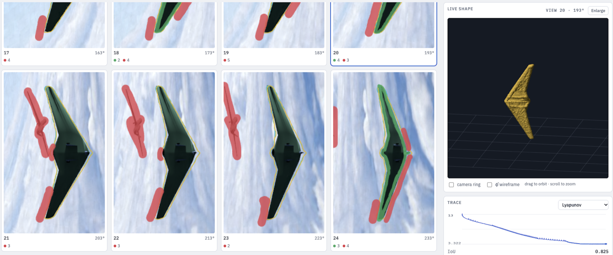

# Interactive 3D Reconstruction

[](https://doi.org/10.5281/zenodo.23885285)
[](LICENSE)
[](https://github.com/ibipul/3d-reconstruction-ui/actions/workflows/tests.yml)
[](https://ibipul.github.io/3d-reconstruction-ui/)
[](pyproject.toml)
[](https://pyodide.org)

A variational feedback control framework that guides silhouette-based 3D reconstruction by level-set
evolution, with user strokes (inside / outside) in the loop, in real time. 
A **live version** runs in the browser at https://ibipul.github.io/3d-reconstruction-ui/. 

The original codebase was developed in MATLAB during the author's doctoral work and led to the publication [cited below](#how-to-cite).


<sub>The browser app on the Sentinel drone dataset. Left: camera views 17–24, with the contour in yellow and user strokes marking inside (green) and outside (red). Right: the live 3D shape and the Lyapunov trace; IoU 0.825.</sub>

## Layout
- `src/recon3d/` – the solver (pure NumPy/SciPy; no UI, no file I/O except `data.py`)
  - `camera.py` cameras and projection · `levelset.py` Sussman re-initialisation, normals, curvature
  - `silhouette.py` masks, visibility, image statistics · `strokes.py` user strokes
  - `solver.py` the iteration loop · `surface.py` level-set mesh · `export.py` strokes to masks · `meshio.py` OBJ/STL/PLY writers
  - `bridge.py` bytes/JSON glue for the web worker
- `web/app/` – the live browser app (Pyodide in a Web Worker). See [web/app/README.md](web/app/README.md)
- `web/mock/` – the static layout mock
- `tests/` – unit tests · `scripts/` – `fetch_data.sh`, `smoke.py`, `export_masks.py`, `smoothing_sweep.py` · `docs/` – porting notes

## How to cite
This is a Python port of the original MATLAB code (`3d-reconstruction-ui-matlab`, private)
behind the paper below. If you use it, please cite **both** the paper and the software. GitHub's
**Cite this repository** button (right sidebar) gives the software citation from [CITATION.cff](CITATION.cff).

> B. Islam, J. Liu, A. Yezzi and R. Sandhu, "An Interactive Control Approach to 3D Shape Reconstruction,"
> *2020 American Control Conference (ACC)*, 2020, pp. 5096–5101, doi: [10.23919/ACC45564.2020.9147728](https://doi.org/10.23919/ACC45564.2020.9147728).
> Preprint: [arXiv:1910.02738](https://arxiv.org/abs/1910.02738).

```bibtex
@inproceedings{islam2020interactive,
  author    = {Islam, Bipul and Liu, Ji and Yezzi, Anthony and Sandhu, Romeil},
  title     = {An Interactive Control Approach to {3D} Shape Reconstruction},
  booktitle = {2020 American Control Conference (ACC)},
  year      = {2020},
  pages     = {5096--5101},
  publisher = {IEEE},
  doi       = {10.23919/ACC45564.2020.9147728}
}
```

And the software:

```bibtex
@software{islam_interactive_3d_reconstruction,
  author    = {Islam, Bipul},
  title     = {Interactive {3D} Reconstruction},
  version   = {0.1.0},
  year      = {2026},
  publisher = {Zenodo},
  doi       = {10.5281/zenodo.23885285},
  url       = {https://github.com/ibipul/3d-reconstruction-ui}
}
```

## Quick start

```sh
python3 -m venv .venv && .venv/bin/pip install numpy scipy pytest pillow
PYTHONPATH=src .venv/bin/python -m pytest -q tests

# the web app (the datasets are committed in web/app/data/<dataset>/; scripts/fetch_data.sh refreshes them)
python3 -m http.server 8000      # then open http://localhost:8000/web/app/

# or run the solver natively and print metrics
PYTHONPATH=src .venv/bin/python scripts/smoke.py 100 30 0.0   # grid, iterations, noise
```

## Status
- Ported: cameras, level-set machinery, silhouette extraction and visibility, the update rule,
  metrics (energy, RMS error, TP/TN/FP/FN, Lyapunov terms), user strokes.
- **Not yet verified against MATLAB.** The tests check invariants (e.g. the fast morphology equals
  scipy's, shift and projection conventions, sphere curvature). Parity with MATLAB output needs
  fixtures from a MATLAB run, and one known approximation: `strel('disk', 6)` is modelled as an
  octagon (R=3 and R=4 match MATLAB's neighbourhoods; R=6 is unconfirmed).
- The grid size is configurable (default 100³; MATLAB uses 150³), so results differ from MATLAB's
  unless run at 150.

## Docs
- [MATLAB codebase map](docs/matlab-architecture.md) – how the original scripts and functions fit together

## License
Licensed under the [Apache License, Version 2.0](LICENSE). The MATLAB implementation this is ported from,
`3d-reconstruction-ui-matlab` (private), is the original codebase,
developed by the author during doctoral work.

The `sentinel_polar` dataset in `web/app/data/` comes from that repository; `zebra` is a set of real photos with no ground truth.
