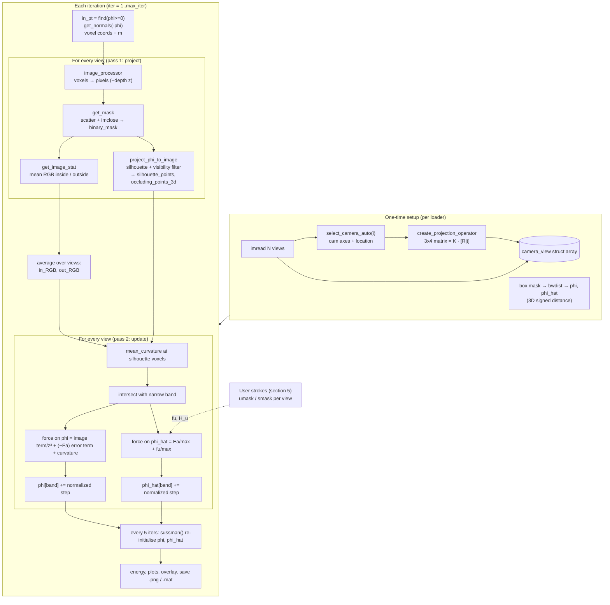

# MATLAB codebase map

Source: [ibipul/3d-reconstruction-ui-matlab](https://github.com/ibipul/3d-reconstruction-ui-matlab) (3,636 lines, 40 `.m` files).
This is a map of how the pieces fit together, written to guide the Python port.

> Items marked **(interpretation)** are my reading of the code, not something the code states. Verify them before relying on them.

## 1. What the program does

It reconstructs a 3D object from N calibrated silhouette-style photos (36 views on a turntable-like circle) by evolving a **3D level-set function `phi`** (a voxel grid of signed distances). The loop projects the current shape into every camera, compares it with the image, and nudges `phi` along the silhouette so the projected shape matches the photos better. A user can additionally **draw strokes on the images** (inside/outside hints) that steer the evolution. This is the "control" part.

There are two level sets:

| Variable | Role |
|---|---|
| `phi` | The reconstruction. Driven by image intensity statistics, depth-weighted gradient, curvature smoothing, and error feedback. |
| `phi_hat` | A second shape (an "ideal"/observer estimate **(interpretation)**). Driven only by the error `Ea = mask(phi) - mask(phi_hat)` and the user strokes `fu`. Shown as the cyan contour (`phi` is yellow). |

`phi >= 0` is **inside** the object (it is built as `-(bwdist(mask) - bwdist(1-mask) + mask)`).

## 2. Entry points

There is no single `main`. Three near-duplicate **loader scripts** are the drivers. They are scripts, not functions, and share one workspace of globals.

| Script | Lines | Dataset | Purpose |
|---|---|---|---|
| `loader_wt_control.m` | 532 | `dataset25` (png) | Baseline. Interaction calls exist but are **commented out**. Saves a `.png` per iteration. |
| `loader_wt_control_v2.m` | 671 | `dataset_hearse` (jpg), 15k iters | **Control-driven run.** At `iter==2` it loads a saved `uinput_bank` `.mat` of recorded user strokes and injects it into every view. Adds Lyapunov-style error traces, directional (±) user masks, `principal_curvature`, and grayscale-image support. |
| `loader_wt_control_rec_error_trace.m` | 739 | `dataset25` + `dataset_sentinel_gt` | **Evaluation run.** Loads a ground-truth silhouette per view and logs RMS error, TP/TN/FP/FN per iteration. Has an optional salt-and-pepper corruption (`imnoise ... .90`) to test robustness. Injection block is removed. |
| `pose_ui.m` | 329 | `dataset27` | Separate single-image experiment. Rotates a shape (`dt_rot`, "rotate normals / coordinates") to fit one view. Not part of the 36-view loop. **(interpretation)** |
| `analysis_code_1.m`, `analysis_code_2.m` | 38 / 244 | – | Post-hoc scratch scripts. They need variables left in the workspace by a loader (`camera_view`, `cview`, `error_track`) and do not run standalone. |
| `useful_control_snippets.m` | 92 | – | Copy-paste blocks that run the interaction loop over all views. See section 5. |

### What differs between the three loaders

Everything outside this table is the same code.

| Aspect | `loader_wt_control` | `_v2` | `_rec_error_trace` |
|---|---|---|---|
| Images | `dataset25/*.png` | `dataset_hearse/*.jpg` | `dataset25/*.png` |
| Ground truth | – | – | `dataset_sentinel_gt/*.png` → `gt_mask` |
| Camera model | `select_camera_auto(i,4,0)` | `select_camera_ttable(i,5,0)` (**not in repo**) | `select_camera_auto(i,4,0)` |
| Grid / object | 150³, rec 80, `f=530` | 160³, rec 90, `f=550` | 150³, rec 80, `f=520` |
| `max_iter` | 5,000 | 15,000 | see file |
| Curvature | `mean_curvature`, weight 0.0001 | `principal_curvature` (computed, then `K_abs` overwritten by ones, so effectively unused), weight 0.001 | like v2 |
| User mask in `phi_hat` force | `H_u = (u != 0)` | split into `H_u_p` (u>0) and `H_u_n` (u<0) | like v2 |
| Control injection | none | `load(...ubank.mat)` at `iter==2` | none |
| Metrics | energy only | + Lyapunov terms `lya_error`, `lyap1/2` | + RMS error, TP/TN/FP/FN, Lyapunov |
| Image saving | every iter | every 10th iter | every iter |

Missing from the repo and needed to reproduce v2: `select_camera_ttable.m`, `dataset_hearse/`, the `uinput_bank` `.mat`.
All paths are hardcoded to `/Users/admin/codes/...`.

## 3. Pipeline overview



## 4. Function-by-function

### 4.1 Camera and projection

| File | What it does |
|---|---|
| `select_camera_auto(index, dist, z_offset)` | Places camera `index` on a circle: angle = `(index-1)*10 + 3` degrees, radius `dist*4`. Looks at the origin; up vector is +Z. Returns rows `[cam_x; cam_y; cam_z; location]`. The loader multiplies the location by 10 (so radius 160). |
| `select_camera(index)` | Older hand-written table of camera poses. A `switch` over view numbers. Unused by the current loaders. |
| `create_projection_operator(cam_x, cam_y, cam_z, loc, img_sz, f)` | Builds the 3×4 matrix `K·[R|−R·c]`. `K` has focal length `f` and the principal point at the image centre. |
| `image_processor(phi_coords, P, sz)` | Applies `P` to homogeneous voxel coordinates, divides by depth (`+1e-5`), casts to `int16`, **clamps** to image bounds. Returns pixel coordinates and the depth `z`. |

### 4.2 Silhouette extraction

| File | What it does |
|---|---|
| `get_mask(row, col, px, nhood)` | Scatters projected voxels into a blank image and applies `imclose` with a disk. This fills the gaps between sparse points and yields `binary_mask`. Also returns the flat pixel index of each voxel (`in_img`). |
| `project_phi_to_image(mask, idx, cam_loc, coords, normals, nhood)` | The key function. (1) Silhouette = mask − erode(mask). (2) Maps silhouette pixels back to voxels. (3) Keeps a voxel only if its normal is nearly perpendicular to the view ray (`dot > -0.15`), and a neighbour within distance `eps=120` also qualifies. Returns `occluding_points_3d` (indices into the voxel list) and `silhoutte_points` (flat pixel indices). |
| `get_image_stat(img, mask)` | Mean R, G, B inside and outside the mask. Returns zeros if the outside is empty. Handles grayscale in the else-branch. |

### 4.3 Level-set machinery

| File | What it does |
|---|---|
| `get_normals(phi, idx)` | `gradient(phi)` sampled at `idx`, normalised (+`1e-5`). Called with `-phi`. |
| `mean_curvature(phi, idx, sz)` | Finite-difference mean curvature at the given voxels. |
| `gaussian_curvature`, `principal_curvature` | Gaussian curvature `K` and `kmax/kmin = H ± sqrt(H²−K)`. Only `_v2` and the trace loader call `principal_curvature`, and `K_abs` is then overwritten. |
| `sussman(D, dt)`, `sussman_sign`, `mymax` | One step of Sussman re-initialisation, restoring `|∇phi| = 1`. Uses upwind differences from the six `shift*` helpers. `mymax` is `max` written as `(a+b+|a−b|)/2`. |
| `shiftB/D/F/L/R/U` | Shift a 3D array by one voxel along one axis, repeating the edge value. |
| `heaviside` | Step function. Not called by the loaders. |

### 4.4 Interaction (the "control")

| File | What it does |
|---|---|
| `regiuster_uinput(img, mask, umask)` | Opens a figure with the image, current user marks (`uoverlay`) and the silhouette (yellow). The user draws an open `imfreehand` stroke. The stroke is thickened by one pixel in 8 directions, clamped to the image, written as value `2`, then `imclose`d. |
| `interact_to(view, iter)` | Calls `regiuster_uinput`, **subtracts** the stroke: `umask = umask − stroke` (negative values). Tag `'o'`. `npts` = 1 if the stroke has at least 72 mass. |
| `erase_from(view, iter)` | Same, but **adds** `3·stroke` (positive values). Tag `'i'`. |
| `clean_up(view)` | Zeroes `umask` wherever a new stroke lands (erase). |
| `diffuse2d(umask)` | 2D heat-equation smoothing to spread a stroke into `smask`. In the snippets it is commented out (`smask = umask`). |
| `uoverlay(img, mask)` | Draws positive marks green and negative marks red via `imoverlay`. |
| `get_uis(camera_views)` | Packs `umask, smask, umask_indices, utype, npts` for all views into `uinput_bank` for saving to a `.mat`. |
| `hat_meet_U` | Intersects user-marked pixels with `phi_hat` pixels. **Not called** by any loader. |
| `remove_self_occlussion` | Older visibility test, same idea as inside `project_phi_to_image` with `eps=5`. **Not called.** |

### 4.5 Per-view state: the `camera_view(i)` struct

`filename, img, cam_x/y/z, camera_loc, projection_operator, umask, smask, umask_indices, utype, npts`
filled during the loop: `binary_mask, binary_mask_hat, in_img, in_img_hat, occluding_points_3d(_hat), silhoutte_points(_hat), depth`
trace loader adds: `gtfilename, gt_mask, rec_error`

## 5. How "control-driven" works

Interaction and reconstruction are **decoupled in time**:

1. **Record.** Run a loader for a while, then run the blocks in `useful_control_snippets.m`. They loop over all views and call `interact_to` (mark outside) and `erase_from` (mark inside), each opening a drawing window. Use `clean_up` to undo.
2. **Bank.** `get_uis(camera_view)` collects the marks and you `save` them as `uinput_bank*.mat`.
3. **Replay.** `loader_wt_control_v2.m` loads the bank at `iter==2` and copies it into every `camera_view(k)`. From then on `fu = u_i` is part of the `phi_hat` force, and in v2 the ± split feeds `eu`.
4. The commented-out blocks inside the loaders (`rem(iter,200)==1` → `interact_to`, `rem(iter,1000)==0` → `erase_from`) show the original live design. Strokes are requested during the run.

**Sign convention needs checking.** `interact_to` is tagged `'o'` and produces negative values. `erase_from` is tagged `'i'` and produces positive values. But `analysis_code_2.m` prints positive sums as "out" and negative sums as "in". In v2, `eu = mask_hat − (H_n − H_p)` treats **negative as inside**. The naming is inconsistent. Settle the convention against real data before porting.

## 6. The update rule per view (the heart of the loop)

At silhouette voxels `s` that survive the visibility test and lie in the narrow band `[−0, +5]`:

```
t        = −Σ_c (in_c − out_c) · (2·I_c(s) − (in_c + out_c))     # per colour channel, Chan–Vese-like
grad_i   = −t / z³                                               # depth-weighted
F        = −max|grad_i| · Ea(s)                                  # error feedback, Ea = mask − mask_hat
grad     = (grad_i + F) / max|grad_i + F|
curv     = −w · H(s) / max|H|                                    # w = 1e-4 (v1) or 1e-3 (v2)
phi[s]  += 0.5 · (grad + curv) / max|grad + curv|

phi_hat[s_hat] += 0.5 · normalize( Ea/max|Ea| + fu/max|fu| )
```

Every 5th iteration both `phi` and `phi_hat` get a `sussman(·, 0.5)` pass. The energy logged each iteration is `Ene = −Σ_c (in_c − out_c)²`; `IEne` is the same for `phi_hat`.

## 7. Things to watch when porting

- **Indexing.** MATLAB is 1-based and column-major. `sub2ind`/`ind2sub`/`find` on 3D arrays give column-major linear indices, and `intersect` depends on them. Use `order='F'` consistently or re-derive.
- **Hardcoded 36.** `if val==36`, `rem(iter,36)+1` in the v1 loader. Use `num_elements`.
- **Image resolution.** Pixel coords are `int16` and clamped to `[1, size]`, so out-of-frame voxels pile up on the border row/column and contribute to the mask. Replicate or fix deliberately.
- **Morphology.** `imclose`, `imerode`, `strel('disk',n)`. Use `scipy.ndimage` or `skimage.morphology`, and check the disk definition matches.
- **`bwdist`.** Becomes `scipy.ndimage.distance_transform_edt`.
- **Float vs uint8 arithmetic.** `get_image_stat` multiplies `uint8` by a `uint8` mask and takes `mean(nonzeros(...))`, so a **black pixel (0) is excluded from the mean**. Copy that quirk or decide to fix it.
- **Visibility test cost.** `project_phi_to_image` loops over candidate points with an O(n²) distance check. Vectorise or use a KD-tree. This matters for the browser build.
- **Dead code.** `heaviside`, `hat_meet_U`, `remove_self_occlussion`, `select_camera`, and v2's `principal_curvature` result can be skipped at first.
- **UI replacement.** `imfreehand` / `imshow` / `saveas` have no direct equivalents. In the browser, strokes become a canvas pointer-event path, then the same "thicken, clamp, write value, close" logic.
- **Data not in the repo.** `select_camera_ttable`, `dataset_hearse`, the `uinput_bank` `.mat` files, and all outputs. For parity tests you only have `dataset25` and `dataset_sentinel_gt` (36 PNGs each).

## 8. Suggested port order (matches this map)

1. `shift*`, `sussman*`, `heaviside`, `get_normals`, curvatures. Pure array maths, easy to test against MATLAB.
2. `select_camera_auto`, `create_projection_operator`, `image_processor`, `get_mask`.
3. `project_phi_to_image`, `get_image_stat`.
4. One function `evolve_step(state, views)` that runs sections 3 and 6 once. Then a loop, then the Sussman cadence.
5. The evaluation metrics from the trace loader.
6. The control layer: `umask`/`smask`, bank load/save, replacing `regiuster_uinput` with a UI-independent "apply stroke" function.
